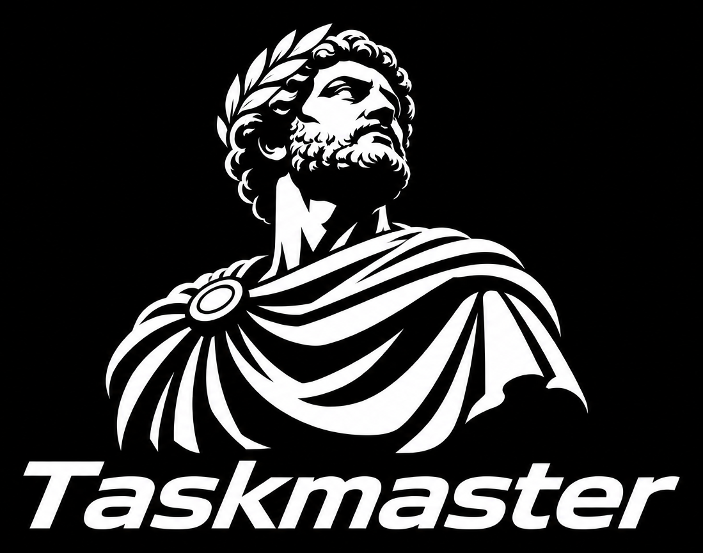

<p align="center">
  
</p>

Taskmaster is a multi-model coding harness. You describe the product once. A planner locks the contracts and the Dictionary. Workers build one page each, in parallel, and cite only those locked entries. A different model reviews the connections, and another confirms the findings before a page is asked to repair them.

The run is a state machine. The models do the writing. Taskmaster decides the next step and records it, so a crashed run resumes from the log instead of from a model's memory.

## A run

1. **Plan.** `--prompt` asks the Taskmaster harness for the contracts, the pages, and the Dictionary entries. `--plan` uses a plan file and skips the model.
2. **Approve.** Without `--yes`, Taskmaster prints the plan and exits. Nothing is built.
3. **Lock.** The contracts are committed, and each page is granted the Dictionary keys it cites.
4. **Build.** Each page gets its own git worktree. Only files matching that page's glob are merged back.
5. **Review.** One reviewer reads each Dictionary connection the changed pages cite, then one security pass reads the dirty pages.
6. **Verify.** A second harness confirms the findings. Confirmed findings go back to the owning page. Then the project's own tools check what was built, and an optional `.taskmaster/verify` program checks the whole tree.

```bash
cargo build --release -p tm-daemon -p tm-review
tm-daemon . --prompt "A small notes app with a list and an editor."
tm-daemon . --yes
```

The first `tm-daemon` command records the plan and exits 2. The second approves that recorded plan and builds it. Pass `--yes` on the first command to approve immediately.

A rejected plan is sent back to the planner once, with the errors. An existing Dictionary entry may be cited. Different content for the same key is refused.

## Who does the work

`--master` chooses the Taskmaster harness. The default is `claude`. The worker defaults to `agy`, the mid tier to `grok`, the reviewer to `claude`, and the verifier to `agy`.

```bash
tm-daemon providers
tm-daemon . --master grok --master-model grok-4.7 --prompt "A small notes app with a list and an editor."
```

`providers` asks every harness which models it offers right now. The JSON says whether the CLI is installed, the command that installs it, the command that signs in, and the model ids. Install and sign-in stay in your hands. Taskmaster prints the commands.

A `--master-model`, `--worker-model`, `--mid-model`, `--reviewer-model`, or `--verifier-model` must be an id that provider just returned. Leave the flag off and the harness keeps its own default.

The harnesses are `claude`, `agy`, `grok`, `codex`, and `opencode`.

## The brakes

A page that fails its checks is sent back with the errors. It gets two repairs on the worker, then two on the mid model, then two on the master. After that, the page fails. A Dictionary entry can be amended once in a run. Review runs for two rounds, and the round after the last one goes straight to verification.

The reviewer and the verifier are different harnesses, so one model does not grade its own page. Findings the verifier rejects are dropped. A write outside the page's glob fails the attempt, including a write to a locked contract. Up to four pages build at once. `--parallel` changes that for a new run. A resumed run keeps the parallelism it started with.

## Checks that cost nothing

Before a run finishes, the files it built are typechecked and linted with tools the project already has: `tsc` from `node_modules`, eslint when it is configured, clippy for Rust, ruff for Python. Only errors count. A type error, a compile error, or a lint rule the project set to `error` goes back to the page that owns the file, and into that model's Errorography. Style warnings do not. An error in a file no page owns is printed and does not fail the run. Taskmaster installs nothing here.

## What a run cost

Every agent call is written to `.taskmaster/runs/<id>/ledger.jsonl`: the role, the page, the harness, the model, the tokens, the seconds, and the price when the harness reports one. The last line a run prints is the total next to the plan's estimate. Cache reads are shown apart from the rest: a harness re-sends its own prompt on every step, the provider serves that from a cache at a reduced rate, and it would otherwise swamp the tokens that reflect the work. `status.json` has the same totals split by role and by model.

Claude Code reports a price. A harness that does not, such as Antigravity, still has its tokens counted, and the dollar total says how many calls it leaves out.

## Dictionary and Commons

The Dictionary is an immutable, content-addressed store. Pages cite keys. They do not invent a second copy of a contract in the brief.

The project store is `.taskmaster/dictionary`. The Commons defaults to `~/.taskmaster/commons`, and workers search it before adding a new entry. A page that passes promotes its new local entries into the Commons. During a run the store is served on `127.0.0.1` with a bearer token for that run. The tools are cite, index, and search.

## What survives the model

**Errorography.** Each model has its own book in `.taskmaster/errorography.json`. The same mistake, three times for that model, is handed back on its next attempt, with a fix when one was learned.

**Citations.** `.taskmaster/citations.json` stores the Dictionary hash each page was built against. A later run skips a page whose cited hashes still match.

**The event log.** `.taskmaster/runs/<id>/events.jsonl` is the run. Replaying it rebuilds the state. The default id is `current`.

## Eval

`--eval` runs the same plan again on one baseline harness and writes `.taskmaster/evals/<id>.json`. Each side reports its pages, its check failures, its tokens, and its cost. A prompt is planned once, and the baseline reuses that plan. The baseline defaults to the master harness. The comparison runs after the plan is approved.

```bash
tm-daemon . --prompt "A small notes app with a list and an editor." --eval --baseline codex --yes
```

## The API

`serve` keeps the daemon up with no run of its own. A frontend starts, approves, rejects, resumes and cancels runs through it, reads the event log and the ledger, searches the Dictionary, and starts reviews.

```bash
tm-daemon serve .
tm-daemon serve . --tailscale
```

The first command listens on `127.0.0.1:8737`. `--tailscale` listens on this machine's Tailscale address, which is how a phone reaches it. The terminal prints a pairing code. A device posts the code once and gets a token; every other call sends that token. Paired devices stay paired across restarts, and only a hash of each token is stored.

```text
POST /api/pair                  {code} -> {token}
GET  /api/runs                  every run, with its phase, pages and spend
POST /api/runs                  {prompt | plan, id?, yes?, roles?, models?, parallel?}
GET  /api/runs/{id}             one run, with its plan
GET  /api/runs/{id}/events      ?after=<n>
GET  /api/runs/{id}/ledger
GET  /api/runs/{id}/changes
POST /api/runs/{id}/approve
POST /api/runs/{id}/reject      {prompt?} plans again when a prompt is given
POST /api/runs/{id}/resume
POST /api/runs/{id}/cancel
GET  /api/providers
GET  /api/dictionary            ?q=<text>
GET  /api/dictionary/{key}
GET  /api/errorography
GET  /api/reviews
POST /api/reviews               {target?, base?, head?, pr?, dirty?}
GET  /api/reviews/{id}
```

One run builds at a time, because a run commits into the project's working tree. `GET /` is a small page for a phone: it pairs, lists the runs, and approves a waiting plan. `--pair` on a run serves the same API on the tailnet for as long as that run lasts.

## Left open on purpose

Three parts are behind traits, so each can be replaced without touching the engine.

| Trait | Today | Later |
| --- | --- | --- |
| `Store` | Files under `.taskmaster/` | A database. Five operations on named records. |
| `Auth` | A pairing code and one token per device | Accounts. `enroll` takes what a sign-in returns, `identify` says whose token it is. |
| `CommonsRemote` | Nothing. The Commons is a directory on this machine. | A Commons shared between people. The daemon already pulls before it plans and pushes each entry it promotes. |

## Review any repository

`tm-review` does not need a Taskmaster plan. It checks out the commits under review and writes the context into that checkout: how the code fits together, what changed, the project's rules, and what earlier reviews of those files found.

```bash
tm-review . --dirty
tm-review https://github.com/org/repo --pr 12
```

Give it a repository or a request on GitHub, GitLab, Bitbucket, Gitea, Forgejo, Codeberg, Azure DevOps, or SourceHut. `--pr` reviews that request on the local `origin`. `--base` and `--head` select a range. The import graph is built from the repo. Clippy, `tsc`, eslint, and ruff run when the diff speaks those languages and the tool is there. `--install-lints` installs clippy when it is missing, and nothing else. A second harness verifies the findings. Confirmed and rejected findings are appended to `.taskmaster/reviews/history.jsonl`.

Rules for the whole project live in `.taskmaster/REVIEW.md`. A `REVIEW.md` further down the tree covers that directory and everything under it. The reviewer defaults to `claude` and the verifier to `agy`.

## Commands

```text
tm-daemon providers [--harness <h>]

tm-daemon serve <project> [--bind <addr>] [--tailscale] [--dictionary <dir>] [--commons <dir>]

tm-daemon <project> [--plan <file> | --prompt <text> | --prompt-file <path>] [--yes]
          [--worker <h>] [--mid <h>] [--master <h>]
          [--reviewer <h>] [--verifier <h>]
          [--worker-model <m>] [--mid-model <m>] [--master-model <m>]
          [--reviewer-model <m>] [--verifier-model <m>]
          [--parallel <n>] [--timeout <secs>] [--dictionary <dir>] [--commons <dir>]
          [--run <id>] [--eval] [--baseline <h>] [--pair]

tm-review <repo | url> [--base <rev>] [--head <rev>] [--pr <n>] [--dirty]
          [--reviewer <h>] [--verifier <h>]
          [--reviewer-model <m>] [--verifier-model <m>] [--install-lints] [--keep]
```

`tm-daemon` exits 0 when the run finishes clean, 1 when it fails, and 2 when the plan is waiting for `--yes`.

Commits the daemon makes need `user.name` and `user.email` on that repository. Taskmaster does not write git config.

## Crates

| Crate | Role |
| --- | --- |
| `tm-core` | The plan, the Dictionary rules, and the run state machine. No I/O. |
| `tm-daemon` | The executor, the ledger, and the API. The binary is `tm-daemon`. |
| `tm-dictionary` | The local store, the Commons, and the MCP server. |
| `tm-harness` | Headless adapters for Claude Code, Antigravity, Grok, Codex, and OpenCode. |
| `tm-verify` | Ownership globs and the import graph. |
| `tm-review` | Review of any git repository. The binary is `tm-review`. |

## Build

```bash
cargo build --release -p tm-daemon -p tm-review
```

The binaries are `target/release/tm-daemon` and `target/release/tm-review`.

## License

MIT.
