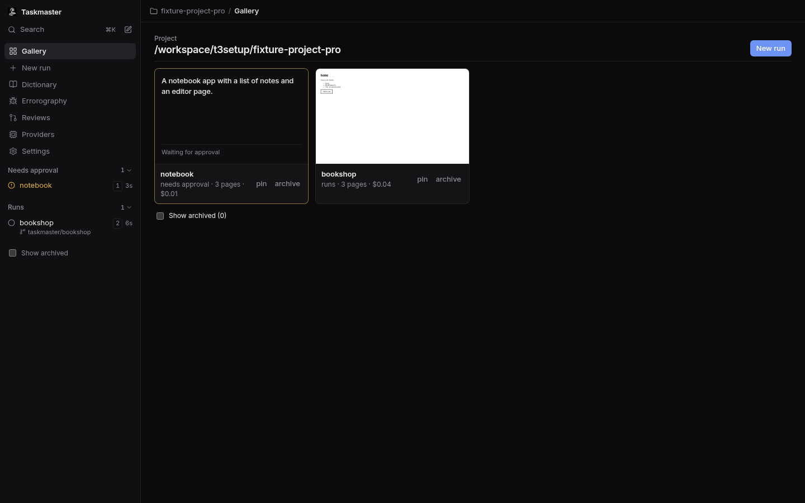
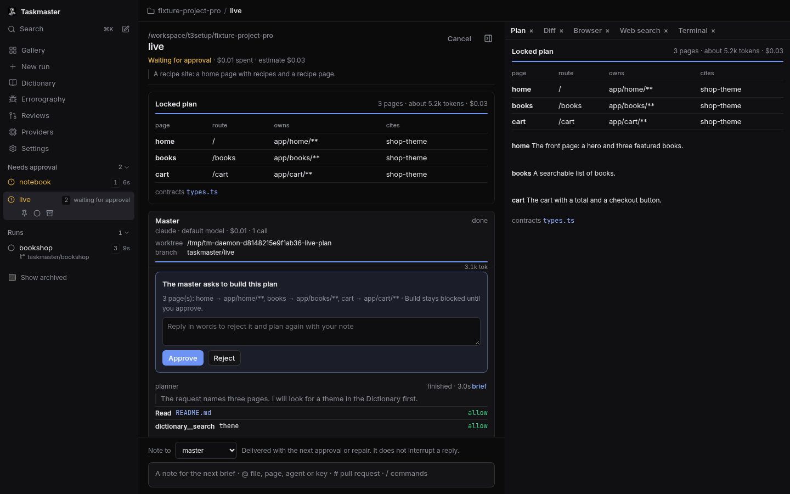
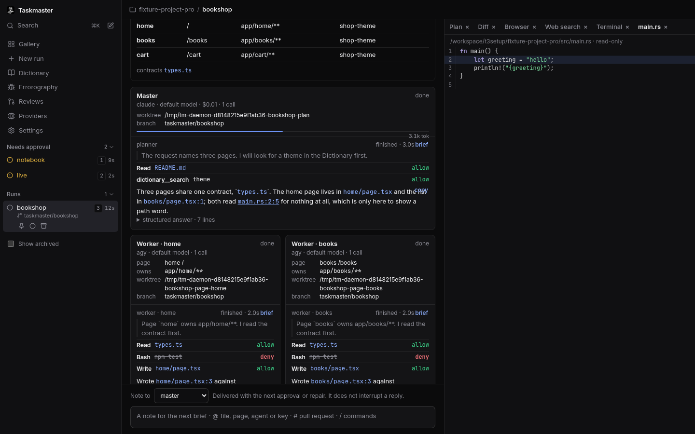
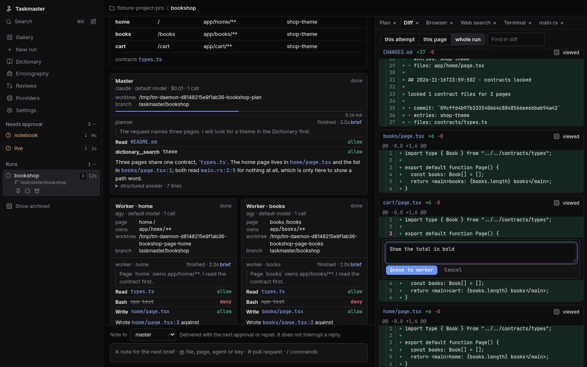
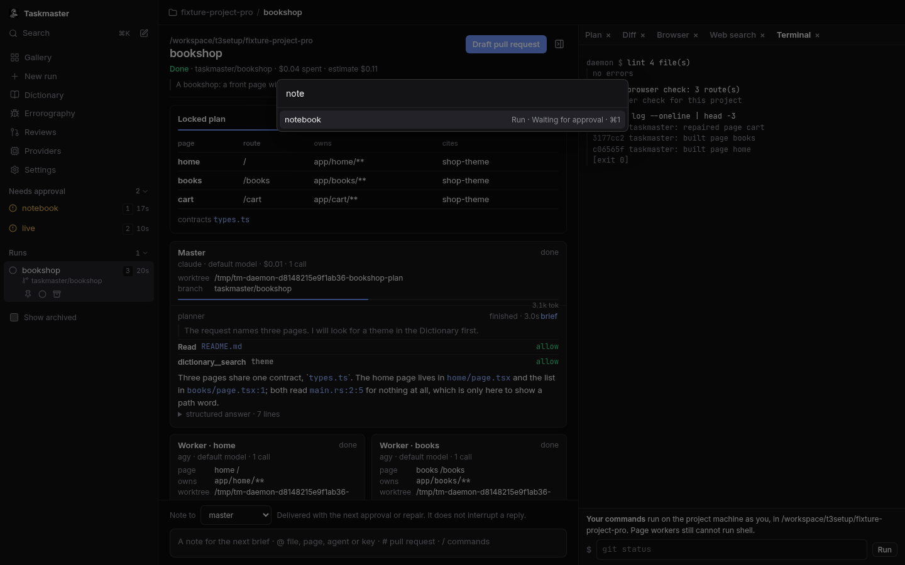
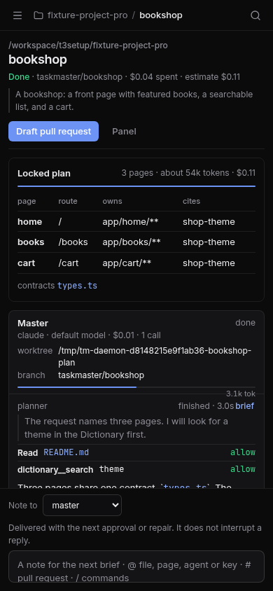

<p align="center">
  
</p>

<h3 align="center">Describe the product once. Let many models build it, and have a different one check the work.</h3>

<p align="center">
  
</p>

## What it is

Taskmaster is a multi-model coding harness. You describe the product once. A planner locks the contracts and the Dictionary. Workers build one page each, in parallel, and cite only those locked entries. A different model reviews the connections, and another confirms the findings before a page is asked to repair them.

The run is a state machine. The models do the writing. Taskmaster decides the next step and records it, so a crashed run resumes from the log instead of from a model's memory.

## Features

- **Locked plan.** Contracts and Dictionary entries are committed before any page is built, and each page is granted only the keys it cites.
- **Parallel pages.** Each page builds in its own git worktree on a run branch, `taskmaster/<run id>`. Only files matching the page's glob are merged. Up to four build at once.
- **Five harnesses.** `claude`, `agy`, `grok`, `codex` and `opencode`, each assigned per role (master, mid, worker, reviewer, verifier).
- **Independent review.** The reviewer and the verifier are different harnesses, so one model does not grade its own page.
- **Checks that cost nothing.** `tsc`, eslint, clippy, ruff, the project's own `build` and `test`, and headless-Chrome checks of a Next.js app, run before a run finishes.
- **Per-tool approval.** `approvals.mode` can ask a person before risky tool calls (shell, network, writes outside the worktree) instead of refusing them.
- **Live preview.** A run's dev server can be started from the app and is stopped with the run.
- **Token ledger.** Every agent call is recorded with input, output, cache-read and cache-write tokens, seconds, and price when the harness reports one; the run view splits them per agent.
- **Providers in the app.** Install, update and sign in to each harness CLI from the Providers page, with the installer's output and the sign-in code shown live. Node, Bun and Python install from there too.
- **One skills store.** SKILL.md skills are searched, installed, switched and updated in one store every harness shares; the planner attaches them to the pages they fit, and `$` in the composer names one.
- **A browser for workers.** A worker on a web page can open, click, type into, screenshot and read the console of its own page's preview, and nothing else.
- **Mid-tier checker (optional).** A second, cheaper look at each finished UI page: the diff, a screenshot, the brief and the done line, answered with pass or a short fix list. Runs beside the build.
- **Code Mode (optional).** Workers get `run_code`, one sandboxed JavaScript call for many steps; Claude Code workers use its own code mode.
- **Dictionary and Commons.** An immutable, content-addressed store of contracts, plus a shared Commons you can opt in to.
- **Errorography.** Each model's repeated mistakes are handed back to it on its next attempt.
- **Resumable.** `events.jsonl` is the run; replaying it rebuilds the state.
- **Review any repo.** `tm-review` reviews a diff, a range or a pull request without a Taskmaster plan.
- **Desktop and phone app.** A desktop app for macOS and Linux that starts and stops tm-daemon and updates itself from GitHub Releases, and the same React app served by the daemon; pair a phone over Tailscale.

## Screenshots

| | |
| --- | --- |
|  |  |
| **Locked plan.** Approve or reject with a note. | **Preview.** The run's dev server beside the run. |
|  |  |
| **Diff.** Comment on a line in the gutter. | **Palette.** Jump to runs, pages and commands. |

<p align="center">
  <br>
  <em>The same app on a phone.</em>
</p>

## Quickstart

You need `cargo` and `git`. Install the CLIs of the harnesses you want to use; `tm-daemon providers` prints the install and sign-in commands.

```bash
scripts/install.sh                       # builds tm-daemon and tm-review, plus the app if npm is present
tm-daemon . --prompt "A small notes app with a list and an editor."
tm-daemon . --yes                        # approve the recorded plan and build it
```

Or use the app:

```bash
cd web && npm ci && npm run build
tm-daemon serve . --web web/dist         # http://127.0.0.1:8737, pair with the printed code
```

`tm-daemon` exits 0 when the run finishes clean, 1 when it fails, and 2 when the plan is waiting for `--yes`.

## Architecture

```text
 web (React + Vite) ──HTTP/SSE──┐
 tm-daemon CLI ─────────────────┤
                                ▼
                         tm-daemon ── executor, ledger, API, git worktrees
                          │   │   │
          decides next ───┘   │   └── tm-dictionary (store, Commons, MCP)
          tm-core             │
          (no I/O)            └── tm-harness ──► claude · agy · grok · codex · opencode
                                  tm-verify (globs, import graph)
                                  tm-review (any repo)

 tm-commons ── shared Commons + sign-in service (tm-token: Ed25519 JWTs)
```

| Crate | Role |
| --- | --- |
| `tm-core` | The plan, the Dictionary rules, and the run state machine. No I/O. |
| `tm-harness` | Headless adapters for Claude Code, Antigravity, Grok, Codex, and OpenCode. |
| `tm-daemon` | The executor, the ledger, and the API. The binary is `tm-daemon`. |
| `tm-commons` | The Commons and sign-in service everyone shares. The binary is `tm-commons`. |
| `tm-dictionary` | The local store, the Commons client, and the MCP server. |
| `tm-verify` | Ownership globs and the import graph. |
| `tm-review` | Review of any git repository. The binary is `tm-review`. |
| `tm-token` | Sign-in tokens: Ed25519 JWTs and the published key. |
| `web/` | The app (React, TypeScript, Vite). Not a crate. |

## A run

1. **Plan.** `--prompt` asks the Taskmaster harness for the contracts, the pages, and the Dictionary entries. `--plan` uses a plan file and skips the model.
2. **Approve.** Without `--yes`, Taskmaster prints the plan and exits. Nothing is built.
3. **Lock.** The contracts are committed, and each page is granted the Dictionary keys it cites.
4. **Build.** The run works on its own branch, `taskmaster/<run id>`, in a checkout outside your working tree. Each page gets its own git worktree, and only files matching that page's glob are merged into the run.
5. **Review.** One reviewer reads each Dictionary connection the changed pages cite, then one security pass reads the dirty pages.
6. **Verify.** A second harness confirms the findings. Confirmed findings go back to the owning page. Then the project's own tools check what was built, and an optional `.taskmaster/verify` program checks the whole tree.

```bash
cargo build --release -p tm-daemon -p tm-review
tm-daemon . --prompt "A small notes app with a list and an editor."
tm-daemon . --yes
```

The first `tm-daemon` command records the plan and exits 2. The second approves that recorded plan and builds it. Pass `--yes` on the first command to approve immediately.

A rejected plan is sent back to the planner once, with the errors. An existing Dictionary entry may be cited. Different content for the same key is refused.

When the run finishes clean, its branch is merged into whatever the project has checked out and then deleted. A run that fails stays on its branch, and so does one git cannot merge cleanly; either way the project is left as it was. A repository with no commit yet has nothing to branch from, so its first run builds in place.

## Starting a project

`--template next` gives a new project its shared files: Next.js 15 with the App Router, React 19 and strict TypeScript. The planner is told the layout, so every page lands in `app/<page id>/` and shared code goes through contract files. A file the project already has is left alone. Any directory works as a template; a `TEMPLATE.md` in it is the note the planner reads.

```bash
tm-daemon . --template next --prompt "A small notes app with a list and an editor."
npm install
```

Taskmaster does not run `npm install`. Once the packages are there, later runs typecheck against them.

## Who does the work

Taskmaster picks no provider for you. Each role (`--master`, `--mid`, `--worker`, `--reviewer`, `--verifier`) takes the harness you name on the command line, or the one saved for the project in `.taskmaster/config.json` under `roles`; a run with a role left unchosen stops and says which. In the app, New Run and the gallery show a provider and model picker for each role. The first time every role is chosen, the answer is saved for the project; after that a choice in New Run applies to that run only, unless you tick "Remember for this project". Settings changes the saved choice.

```bash
tm-daemon providers
tm-daemon . --master grok --master-model grok-4.7 --prompt "A small notes app with a list and an editor."
```

`providers` asks every harness which models it offers right now. The JSON says whether the CLI is installed, the command that installs it, the command that signs in, and the model ids. Install and sign-in stay in your hands. Taskmaster prints the commands.

A `--master-model`, `--worker-model`, `--mid-model`, `--reviewer-model`, or `--verifier-model` must be an id that provider just returned. Leave the flag off and the harness keeps its own default.

The harnesses are `claude`, `agy`, `grok`, `codex`, and `opencode`.

## The brakes

A page that fails its checks is sent back with the errors. It gets two repairs on the worker, then two on the mid model, then two on the master. After that, the page fails. A Dictionary entry can be amended once in a run. Review runs for two rounds, and the round after the last one goes straight to verification.

The reviewer and the verifier are different harnesses, so one model does not grade its own page. Findings the verifier rejects are dropped. A write outside the page's glob fails the attempt, including a write to a locked contract. Up to four pages build at once. `--parallel` changes that for a new run. A resumed run keeps the parallelism it started with.

## Checks that cost nothing

Before a run finishes, the files it built are typechecked and linted with tools the project already has: `tsc` from `node_modules`, eslint when it is configured, clippy for Rust, ruff for Python. Only errors count. A type error, a compile error, or a lint rule the project set to `error` goes back to the page that owns the file, and into that model's Errorography. Style warnings do not. An error in a shared file the run wrote, a contract or a template file, goes to the master, which may edit those files and nothing else. It gets two such repairs in a run; if the file still fails, the run fails. An error in a file the run did not write was there before, so it is printed and left alone. Taskmaster installs nothing here.

When the types are clean, the project is run. Its own `build` and `test` scripts run through the package manager its lockfile names (npm, pnpm, yarn or bun). A Rust project gets `cargo test`, and a Python project with a test directory gets `pytest`. Each failure goes back to the page whose file or route the output names. A failure that names a shared file the run wrote goes to the master. One that names neither is printed and costs nothing.

A Next.js app that built is then started and opened in headless Chrome, one page per route, over the DevTools protocol. A dynamic segment such as `[id]` gets a sample value, and its 404 is not counted against it. The page gets back:
- an error status;
- an uncaught exception;
- a `console.error`;
- a resource that failed to load.

A screenshot of each page is kept, and the app shows it next to the page. Chrome is found on `PATH`, or at `$TASKMASTER_CHROME`. `--no-runtime-checks` skips all of this.

## Handing over

Each attempt at a page is kept in `.taskmaster/runs/<id>/attempts/<page>.jsonl`: the model, what it was asked to fix, the files it changed, what it said when it finished, and why it was not kept. When a page goes back for repair, or up to a stronger model, the next attempt is given the last two. A change that was thrown away is included as a diff, since it is not in the tree. A kept one is already in the files, and the brief says to build on it.

## What a run cost

Every agent call is written to `.taskmaster/runs/<id>/ledger.jsonl`: the role, the page, the harness, the model, the tokens, the seconds, and the price when the harness reports one. The estimate is not the planner's guess. It is worked out from what build and review calls cost in this project's earlier runs, or from defaults on a first run. The last line a run prints is the total next to that estimate. Cache reads are shown apart from the rest: a harness re-sends its own prompt on every step, the provider serves that from a cache at a reduced rate, and it would otherwise swamp the tokens that reflect the work. `status.json` has the same totals split by role and by model.

Claude Code reports a price. A harness that does not, such as Antigravity, still has its tokens counted, and the dollar total says how many calls it leaves out.

## Dictionary and Commons

The Dictionary is an immutable, content-addressed store. Pages cite keys. They do not invent a second copy of a contract in the brief.

The project store is `.taskmaster/dictionary`. The Commons defaults to `~/.taskmaster/commons`, and workers search it before adding a new entry. A page that passes promotes its new local entries into the Commons. During a run the store is served on `127.0.0.1` with a bearer token for that run. The tools are cite, index, and search.

## What survives the model

**Errorography.** Each model has its own book in `.taskmaster/errorography.json`. The same mistake, three times for that model, is handed back on its next attempt, with a fix when one was learned.

**Citations.** `.taskmaster/citations.json` stores the Dictionary hash each page was built against. A later run skips a page whose cited hashes still match. A page is recorded only once its run is merged, so a run left on its branch does not make the next one skip anything.

**The event log.** `.taskmaster/runs/<id>/events.jsonl` is the run. Replaying it rebuilds the state. The default id is `current`.

## Optional: the checker and Code Mode

Both are off until you switch them on in Settings (or `checker.enabled` and `code_mode.enabled` in the settings file).

The **checker** gives a page that just passed its own checks one read-only call on the mid role's model, but only when the page changes UI files, is large, or needed a stronger tier. It reads `diff.patch`, a screenshot of the page as the worker left it, the brief, the done line and the worker's last words, and answers `pass` or up to five fixes. Those fixes join the verify step's errors, so the page is repaired the usual way. Each page is checked once, the check runs beside the rest of the build, and verification waits at most 20 seconds for a check still running.

**Code Mode** gives each worker `run_code`: an async JavaScript body with `read`, `write`, `edit`, `grep`, `ls`, `sh`, `check` and `browser`, run in Node with its permission model on (no files, processes or workers of its own) and, under bubblewrap, no network. Every call goes to the same permission gate as the worker's own tools. Claude Code workers instead run Claude Code's native code mode (`CLAUDE_CODE_EXPERIMENTAL_CODE_MODE=1`) in an interactive session on a terminal.

`scripts/bench.sh` builds one locked plan under different settings, and runs a single-agent baseline, writing each result to `bench/results.jsonl`.

## Eval

`--eval` runs the same plan again on one baseline harness and writes `.taskmaster/evals/<id>.json`. Each side reports its pages, its check failures, its tokens, and its cost. A prompt is planned once, and the baseline reuses that plan. The baseline starts from the same commit. It is measured and then discarded: the project keeps the Taskmaster result. The baseline defaults to the master harness. The comparison runs after the plan is approved.

```bash
tm-daemon . --prompt "A small notes app with a list and an editor." --eval --baseline codex --yes
```

## The API

`serve` keeps the daemon up with no run of its own. A frontend starts, approves, rejects, resumes and cancels runs through it, reads the event log and the ledger, searches the Dictionary, and starts reviews.

```bash
tm-daemon serve .
tm-daemon serve . --tailscale
```

The first command listens on `127.0.0.1:8737`. `--tailscale` listens on this machine's Tailscale address, which is how a phone reaches it. The terminal prints a pairing code. A device posts the code once and gets a token; every other call sends that token. Paired devices stay paired across restarts, and only a hash of each token is stored.

```text
POST /api/pair                  {code} -> {token}
GET  /api/runs                  every run, with its phase, pages and spend
POST /api/runs                  {prompt | plan, id?, yes?, roles?, models?, parallel?, template?}
GET  /api/runs/{id}             one run, with its plan
GET  /api/runs/{id}/events      ?after=<n>
GET  /api/runs/{id}/stream      the same events as they happen
GET  /api/runs/{id}/ledger
GET  /api/runs/{id}/changes
POST /api/runs/{id}/approve
POST /api/runs/{id}/reject      {prompt?} plans again when a prompt is given
POST /api/runs/{id}/resume
POST /api/runs/{id}/cancel
GET  /api/providers
GET  /api/templates
GET  /api/dictionary            ?q=<text>
GET  /api/dictionary/{key}
GET  /api/errorography
GET  /api/reviews
POST /api/reviews               {target?, base?, head?, pr?, dirty?}
GET  /api/reviews/{id}
GET  /api/commons/entries       this daemon's Commons, for another daemon to pull
POST /api/commons/entries       an entry another daemon promoted
```

`stream` is server-sent events: one `event` per entry in the run's log, then `idle` with the phase once nothing is driving the run. A browser's `EventSource` cannot send a header, so this one route also takes `?token=`.

Each run is on its own branch, so several can build at once. `--pair` on a run serves the same API on the tailnet for as long as that run lasts.

## The app

`web/` is the frontend: React and TypeScript, built with Vite. The daemon serves it, so there is nothing else to run. It works the same on a phone and on a desktop, and a phone can add it to the home screen.

- Pair with the code, or sign in with an account when accounts are set up.
- Start a run: the prompt, a template, how many pages at once, and the harness and model for each role.
- Read the plan, then approve it, change it, or cancel. Follow a run as it happens.
- See what a run cost by role, by model, and by call, with cache reads apart.
- Read what each run committed, search the Dictionary, read the Errorography, and start and read reviews.

```bash
cd web && npm ci && npm run build
tm-daemon serve . --web web/dist
```

Without `--web`, the daemon serves `$TASKMASTER_WEB` or `~/.local/share/taskmaster/web`, where the install script puts the build. With neither, `/` is a small built-in page that pairs, lists runs, and approves a plan.

To work on the app, run `npm run dev` in `web/` next to `tm-daemon serve`. Vite sends `/api` to `127.0.0.1:8737`, or to `$TASKMASTER_DAEMON`. A build served from somewhere else can name the daemon on its sign-in screen; the API allows any origin, because it authenticates with tokens, not cookies.

## Configuration

Settings live in `.taskmaster/config.json` in the project, or `~/.taskmaster/config.json`. Without the file nothing changes. Copy `config.example.json` and fill in one part at a time; a placeholder counts as not set. Never commit real tokens.

| Key | Default | Meaning |
| --- | --- | --- |
| `store.kind`, `store.path` | `files` | `"sqlite"` keeps records in one SQLite file (`.taskmaster/taskmaster.db`). |
| `auth.issuer`, `auth.allow` | pairing code only | Also accept Commons sign-in; only accounts in `allow` (`github:<login>`, `google:<email>`) get in. |
| `commons.remote`, `commons.token`, `commons.share`, `commons.report` | local Commons | Connect to the shared Commons; `share` sends promoted entries, `report` reports pass results. |
| `approvals.mode`, `approvals.timeout_secs` | `never`, 600 | `never` refuses risky calls, `risky` asks first, `always` asks for every tool call. Unanswered questions are refused after the timeout. |
| `editor` | `$VISUAL`, then `$EDITOR` | The editor the app's Open action uses. |
| `preview.command` | the project's `dev` script | Command that starts the preview server; it gets the port as `$PORT`. |

Environment variables:

| Variable | Used by | Meaning |
| --- | --- | --- |
| `TASKMASTER_WEB` | `tm-daemon serve` | Built app to serve when `--web` is not given (else `~/.local/share/taskmaster/web`). |
| `TASKMASTER_DAEMON` | `npm run dev` in `web/` | Daemon the Vite dev server proxies `/api` to (default `http://127.0.0.1:8737`). |
| `TASKMASTER_CHROME` | runtime checks | Chrome binary, when it is not on `PATH`. |
| `TASKMASTER_GH` | pull-request actions | GitHub CLI program, default `gh` (mainly for tests). |
| `TM_COMMONS_URL`, `TM_COMMONS_BIND`, `TM_COMMONS_SESSION_SECRET`, `TM_COMMONS_SIGNING_KEY`, `TM_COMMONS_MODERATORS`, `TM_COMMONS_DAILY_LIMIT` | `tm-commons` | Server settings; see `deploy/commons/`. |

### The Taskmaster Commons

`tm-commons` is one service for everyone. It signs people in with GitHub or Google, and serves the entries people chose to share. Your Taskmaster pulls those entries before it plans, and deletes any entry the Commons has withdrawn.

Sharing works like this:
- With `share` on, your Taskmaster sends each entry your runs promote.
- Before anyone else gets an entry, the service refuses anything that looks like a credential, and a moderator approves it in the weekly review.
- `report`, on by default, says whether pages that used a Commons entry passed. That is how an entry earns its pass rate in other people's runs.
- Moderators withdraw entries that are reported or that keep failing, and can ban someone.

The service signs sign-in tokens with an Ed25519 key and publishes the public half. A Taskmaster checks tokens with that public key alone, and holds nothing that could make one.

`deploy/commons/` has what the server needs: how to set it up, the environment file with placeholders, a systemd unit and a Caddy config. A daemon can also act as a hub for a group, through `GET` and `POST /api/commons/entries`.

## Review any repository

`tm-review` does not need a Taskmaster plan. It checks out the commits under review and writes the context into that checkout: how the code fits together, what changed, the project's rules, and what earlier reviews of those files found.

```bash
tm-review . --dirty
tm-review https://github.com/org/repo --pr 12
```

Give it a repository or a request on GitHub, GitLab, Bitbucket, Gitea, Forgejo, Codeberg, Azure DevOps, or SourceHut. `--pr` reviews that request on the local `origin`. `--base` and `--head` select a range. The import graph is built from the repo. Clippy, `tsc`, eslint, and ruff run when the diff speaks those languages and the tool is there. `--install-lints` installs clippy when it is missing, and nothing else. A second harness verifies the findings. Confirmed and rejected findings are appended to `.taskmaster/reviews/history.jsonl`.

Rules for the whole project live in `.taskmaster/REVIEW.md`. A `REVIEW.md` further down the tree covers that directory and everything under it. The reviewer defaults to `claude` and the verifier to `agy`.

## Commands

```text
tm-daemon providers [--harness <h>]

tm-daemon serve <project> [--bind <addr>] [--tailscale] [--dictionary <dir>] [--commons <dir>] [--web <dir>]

tm-daemon <project> [--plan <file> | --prompt <text> | --prompt-file <path>] [--yes]
          [--worker <h>] [--mid <h>] [--master <h>]
          [--reviewer <h>] [--verifier <h>]
          [--worker-model <m>] [--mid-model <m>] [--master-model <m>]
          [--reviewer-model <m>] [--verifier-model <m>]
          [--parallel <n>] [--timeout <secs>] [--dictionary <dir>] [--commons <dir>]
          [--run <id>] [--template <next | dir>] [--eval] [--baseline <h>] [--pair]
          [--no-runtime-checks]

tm-commons serve | check | keygen      the Commons service; see deploy/commons

tm-review <repo | url> [--base <rev>] [--head <rev>] [--pr <n>] [--dirty]
          [--reviewer <h>] [--verifier <h>]
          [--reviewer-model <m>] [--verifier-model <m>] [--install-lints] [--keep]
```

`tm-daemon` exits 0 when the run finishes clean, 1 when it fails, and 2 when the plan is waiting for `--yes`.

Commits the daemon makes need `user.name` and `user.email` on that repository. Taskmaster does not write git config.

## Install

```bash
scripts/install.sh
```

This builds both binaries and copies them to `~/.local/bin`, or to the directory you pass. It needs `cargo` and `git`. With `npm` present it also builds the app into `~/.local/share/taskmaster/web`, where `serve` finds it. Antigravity, Grok Build and OpenCode are confined with bubblewrap, so those three also need `bwrap`. A tag starting with `v` builds a Linux release on GitHub.

To build without installing: `cargo build --release -p tm-daemon -p tm-review`. A harness is found on `PATH`, and also in `~/.local/bin` and `~/.opencode/bin`.

## Releases and the site

A `v*` tag builds the Linux server tarball and the signed desktop installers, with `latest.json` for the in-app updater and `SHA256SUMS.txt`; see [docs/RELEASING.md](docs/RELEASING.md) for the secrets. `site/` builds the public landing page and releases page as static files for Caddy; see [deploy/site/README.md](deploy/site/README.md).

## Contributing

```bash
cargo test --workspace        # Rust
cd web && npm ci && npm run typecheck && npm run build
cd web && npm run e2e           # Playwright, the built app on a real tm-daemon (system Chrome)
cd site && npm test            # the public site's generator
```

Run `npm run dev` in `web/` next to `tm-daemon serve .` to work on the app. `tm-core` does no I/O; keep it that way. Commits the daemon makes need `user.name` and `user.email` set on the repository.

## License

MIT.
