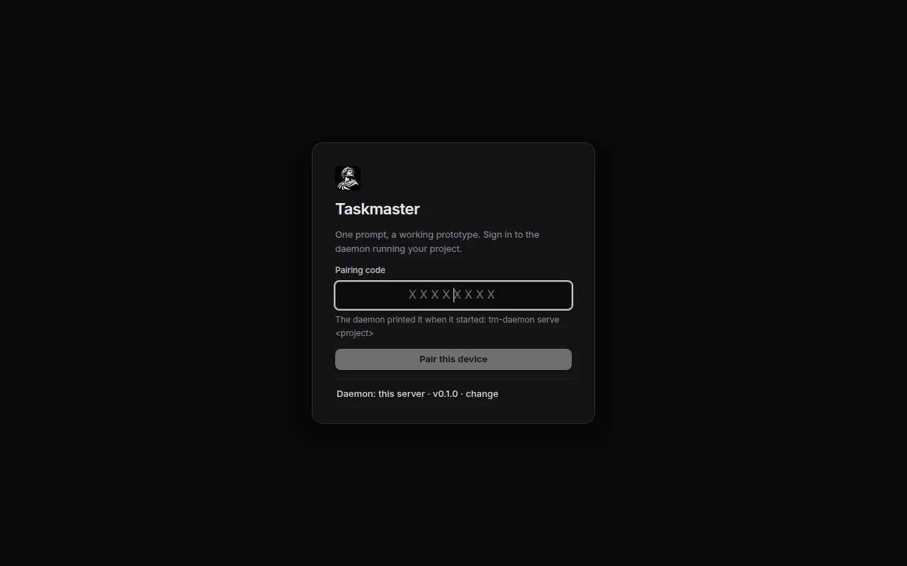

<p align="center">
  
</p>

<h1 align="center">Taskmaster</h1>

<p align="center">One master plans the product. Many workers build it in parallel. A different model checks every unit.</p>

<p align="center">
  <a href="https://github.com/narensen/Taskmaster/releases/latest"><strong>Download</strong></a> ·
  <a href="docs/GUIDE.md">Guide</a> ·
  <a href="docs/ROADMAP.md">Roadmap</a> ·
  <a href="docs/RELEASING.md">Releasing</a> ·
  <a href="https://www.taskmaster-commons.duckdns.org">Website</a>
</p>

<p align="center">
  
</p>

Taskmaster is a local, multi-model coding harness and run studio. You describe a web app, library, CLI, server, or migration once (or import a GitHub/GitLab issue with screenshots and files). The master researches unfamiliar APIs, locks shared contracts and executable contract tests, and splits the build across up to 16 parallel workers in isolated git worktrees. Fast checks run as each unit merges, and a separate reviewer and verifier grade the result before a run is called done.

It drives the coding CLIs you already use: **Claude Code**, **Codex**, **Grok Build**, **Antigravity**, and **OpenCode**. You pick a provider and model for each role — Master, Mid, Worker, Reviewer, and Verifier — or let the stratified model scorecard auto-route workers.

<table>
  <tr>
    <td><b>Locked plans &amp; contract tests</b></td>
    <td>Shared interfaces, Dictionary entries, and executable acceptance tests are committed before workers spawn, so parallel units cannot drift apart. Big jobs run in 2–6 phases tracked in <code>PROJECT.md</code>.</td>
  </tr>
  <tr>
    <td><b>Parallel sandboxed worktrees</b></td>
    <td>Each unit builds in its own git worktree with a read-only machine view (bubblewrap or Codex sandbox) and merges back only the files it owns through a serialized merge queue.</td>
  </tr>
  <tr>
    <td><b>Streaming checks &amp; warm LSP</b></td>
    <td>Deterministic auto-fixers (<code>eslint --fix</code>, <code>ruff --fix</code>), warm language servers, incremental per-page type/lint checks, project tests, and headless-browser checks catch errors before any model reviews.</td>
  </tr>
  <tr>
    <td><b>Daemon-mediated web access</b></td>
    <td>Optional <code>web_search</code>, SSRF-hardened <code>web_fetch</code>, OSV security <code>advisories</code>, and offline-first <code>docs()</code> stay inside the daemon — cached, budgeted, audited, and framed as untrusted data.</td>
  </tr>
  <tr>
    <td><b>Independent cross-model review</b></td>
    <td>A separate reviewer checks connections and security (including OSV advisories), a separate verifier confirms findings, and a red/green proof gate validates fixes.</td>
  </tr>
  <tr>
    <td><b>Token ledger &amp; spend controls</b></td>
    <td>Every call records input, output, cache read/write tokens, duration, and USD cost, with per-run and monthly spend caps and a stratified <code>(model, difficulty, language)</code> scorecard.</td>
  </tr>
  <tr>
    <td><b>Resumable &amp; reversible</b></td>
    <td>Every run is an event-sourced log (<code>events.jsonl</code>) with checkpoints, run forking, graceful or immediate cancel, <code>--auto-resume</code>, and one-click undo of merged runs.</td>
  </tr>
</table>

## Install

One short line per platform. Verify the download with the checksum file that ships with every release.

| Platform | Get it |
| --- | --- |
| Ubuntu / Debian | `Taskmaster_<version>_amd64.deb` from [Releases](https://github.com/narensen/Taskmaster/releases/latest), then `sudo apt install ./Taskmaster_<version>_amd64.deb`. Installs the desktop app and `tm-daemon` on `PATH`, and recommends `bubblewrap` (the workers' sandbox) and `python3-venv`. |
| Any Linux | `Taskmaster_<version>_amd64.AppImage`, then `chmod +x` and run it. |
| Linux server (headless) | `taskmaster-v<version>-x86_64-linux.tar.gz`, then `./install.sh` inside it. Installs `tm-daemon` (also as `taskmaster`) to `~/.local/bin` and the web app to `~/.local/share/taskmaster/web`. `~/.local/share/taskmaster/uninstall.sh` removes it. |
| macOS | `Taskmaster_<version>_aarch64.dmg` (Apple silicon) or `_x64.dmg` (Intel). Without a Developer ID it is signed ad hoc: open it once with right-click → Open. Or build from source with `scripts/install.sh`. |
| Windows | `Taskmaster_<version>_x64-setup.exe` or `.msi`. SmartScreen warns until the installers are signed. |
| From source | Run `scripts/install.sh` (installs `tm-daemon`, `tm-review`, the built web studio, and the user-level `systemd` service on Linux or `launchd` agent on macOS). |

Then install and sign in to at least one provider. `tm-daemon providers` prints the install and sign-in commands for each one.

Verify a release download:

```bash
sha256sum -c SHA256SUMS.txt
```

## Use

```bash
tm-daemon serve .                            # start the Studio at http://127.0.0.1:8737
tm-daemon serve . --lan                      # also reachable from the local network and tailnet (pair with a link)
tm-daemon serve . --auto-resume              # resume unfinished runs on daemon startup
tm-daemon . --prompt "A notes app with a list and an editor."
tm-daemon . --yes                            # approve the plan and build it
tm-daemon . --worker auto --yes              # auto-route workers from the local scorecard
tm-daemon report .                           # inspect run cost, tokens, and outcomes
tm-daemon eval --suite bench/suite --check-only
```

The [guide](docs/GUIDE.md) covers roles, configuration, the HTTP API, Commons, and reviewing any repository standalone with `tm-review`.

## Connect

Everything that reaches the daemon lives on the **Connect** page (`/connect`, or `Ctrl+K` → *Pair a phone*).

- **Pair a device with a link.** *Make pairing link* shows a QR code and one link per address the daemon has (this computer, the local network, Tailscale). Opening it on a phone or another computer signs that device in with nothing to type. A link works once, for ten minutes; the code rides after `#`, so it never reaches a server log. The daemon also prints a link for its startup code.
- **Reach it from other devices.** `tm-daemon serve . --lan` listens on the local network and the tailnet; `--tailscale` on the tailnet only. By default only this computer can connect.
- **Devices.** Every paired device has a name, a kind and a last-seen time. Rename it, or revoke it: its token stops working at once.
- **Other machines.** Paste another daemon's pairing link to add it; its runs, status and what needs you show beside this one's.
- **Outside agents over MCP.** Make a token for Claude Code, Codex, Cursor or any MCP client and paste the setup shown, for example:

  ```bash
  claude mcp add --transport http taskmaster http://127.0.0.1:8737/mcp --header "Authorization: Bearer <token>"
  ```

  The agent can then list, start (`mode`: auto, code or agent), wait for, read, steer, approve, cancel and preview runs. Each tool calls the same handlers the app does.
- **Prompt links.** `/runs/new?prompt=…&mode=agent` opens New Run with the prompt ready; it never sends on its own, and hidden characters are removed with a warning. Every run has a *Copy link* button.
- **Reconnects.** If the daemon stops answering, a line says so and retries with backoff; the page catches up when it answers.

## Web access & local-first docs

Off by default (`Settings → Web access`). Worker sandboxes keep `--unshare-net`; all web traffic goes through the daemon so every request is cached, budgeted, and logged in the egress audit log and run transcript.

- **Local-first `docs(package, symbol?)`** — always available offline. Reads READMEs and type definitions directly from `node_modules`, Python `site-packages`, or `~/.cargo/registry/src` at the project's locked version before falling back to search.
- **`web_search`** — supports **SearXNG**, **Brave Search**, **Tavily**, **Exa**, or **Native** provider passthrough (allowing a harness's built-in search tool per role through the permission gate). API keys are stored in the OS keychain vault and redacted from logs and exports.
- **SSRF-safe `web_fetch`** — HTTPS only, pinned DNS resolution to stop DNS rebinding, blocks loopback/RFC 1918/link-local/metadata/internal addresses on every redirect hop, enforces response size and content-type limits, extracts markdown from HTML and text from PDFs, and caches pages under `$XDG_CACHE_HOME/taskmaster/web`.
- **OSV security `advisories`** — queries `api.osv.dev` for package vulnerabilities during reviews and dependency checks.
- **Per-role permissions & budgets** — Planner researches up to a configurable search/fetch cap and writes concise decisions (with source URL and version) into `PROJECT.md`; Workers fetch only from a project-derived + custom domain allowlist (off-list domains trigger an approval prompt in `risky` mode); Reviewers check security advisories; Verifiers get no web access.
- **Prompt-injection framing** — strips HTML comments, hidden elements, and zero-width characters, flags imperative injection patterns, wraps results in untrusted provenance tags, and prevents raw web content from entering the workers' shared prefix.
- **Per-run Web sources view** — Run View displays every agent's searches, fetched URLs, cache hits, local docs lookups, advisory checks, injection warnings, and planner research decisions.

## Code Mode & warm code intelligence

Code Mode is **on by default** (`code_mode.enabled`). Workers (and read-only planners/reviewers) receive `run_code`: a sandboxed async JavaScript runtime behind the same permission gate as their native tools, exposing `read`, `readMany`, `write`, `edit`, `patch`, `applyPatch`, `tryPatch`, `testAffected`, `grep`, `ls`, `diff`, `symbols`, `sh`, `test`, `check`, and `browser` (scoped strictly to the run's preview origin). Claude Code workers use Claude Code's native code mode.

Alongside Code Mode, the daemon maintains:

- **Warm LSP pool** — keeps language servers (`typescript-language-server`, `pyright`/`basedpyright`, `rust-analyzer`) warm per run tree for instant `diagnostics`, `outline`, `definition`, and `references`, feeding diagnostics straight back after writes.
- **Codebase Atlas & context packs** — deterministic repo map and per-unit import-graph context packs keep prompts small and prompt-cache hit rates high.
- **Difficulty-aware routing & hedging** — easy units run at low effort, hard units can start directly on the Mid tier or race best-of-N within budget, and stalled/repeating repairs escalate immediately.

## Recursive self-improvement

Taskmaster improves the more you run it because every failure and fix feeds back into future runs:

- **Errorography & repair playbooks.** Check failures are keyed by tool and error code (`tsc TS2304`, `ruff F401`) per model (`errorography.json`). Repeated mistakes carry the learned fix — including fixes discovered on higher tiers — into future attempts.
- **Project memory.** Confirmed build, test, and environment fixes are snapshotted at run start and shared across every worker without breaking prompt-cache stability.
- **Stratified model scorecard.** Tracks first-pass rate, average cost, and latency per `(model, difficulty, language)`, recommends the cheapest worker hitting ≥85% first-pass success, warns when a chosen worker is struggling, and powers `--worker auto`.
- **Dictionary citations.** Each unit records the Dictionary hashes it was built against; later runs skip units whose cited contracts still match.
- **Reviews that learn.** Independent reviewer and verifier findings (confirmed and rejected) feed into subsequent review passes.
- **Event-sourced runs.** `events.jsonl` is the source of truth, so crashes, provider quota / HTTP 429 stops (exit code `75`, `EX_TEMPFAIL`), auth/balance stops (exit code `3`), or daemon restarts pick up cleanly from the log.

## Studio, operations & safety

- **4-Lens Run Studio & Approval Dock** — switch between **Mission** (live DAG, phases, reasoning glimpses, Web sources), **Review** (findings, PR CI sync, diff inspection), **Telemetry** (4-way token split, cache economics, latency), and **Files**, with a live approval dock for risky tool or off-allowlist fetch requests.
- **Workflow integrations** — import prompts directly from GitHub/GitLab issue URLs, attach mockups/images/files to runs, connect custom user MCP servers with vaulted secrets, sync PR CI failures and review comments back into repair loops, configure webhook notifications, and schedule recurring runs.
- **Production hardening** — OS keychain secret vault with universal redaction, Policy-as-Code rules, Preflight Doctor checks before spending tokens, egress allow/deny policy and audit log, supply-chain dependency checks, Flight Recorder debug bundles, run checkpoints and forking, one-click Undo of merged runs, retention GC, `Idempotency-Key` support, Prometheus `/metrics`, and a remote runner mesh.

## Develop

```bash
cargo clippy -p tm-core -p tm-harness -p tm-daemon --offline --all-targets -- -D warnings
cargo test --workspace
npm run typecheck --prefix web && npm run build --prefix web
cd web && npm run e2e
```

Run the hidden-test benchmark suite check:

```bash
cargo run -p tm-daemon -- eval --suite bench/suite --check-only
```

## License

MIT.